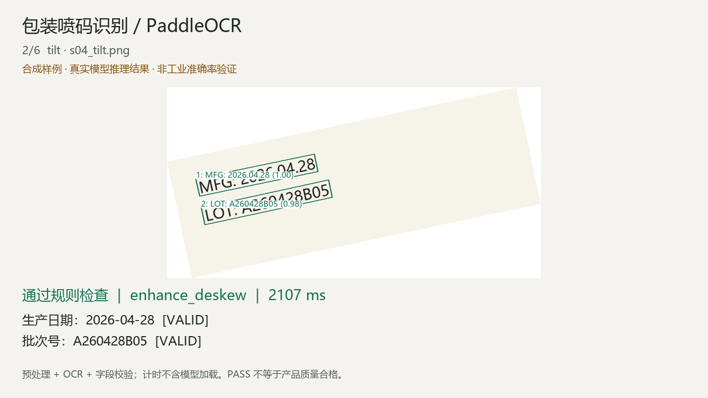

# 基于 PaddleOCR 的包装喷码识别系统

个人/课程项目，面向单个包装喷码区域的生产日期与批次号识别。使用 Python、OpenCV、PaddleOCR 3.x 和 Tkinter，支持 CPU。已有代码、桌面界面、命令行、合成样例、评估工具和回归测试；真实包装效果需用自己的实拍数据检验。

交付导航：[实测报告](实测报告.md) · [演示视频](demo/demo.mp4) · [演示 GIF](demo/demo.gif) · [逐图评估数据](evaluation/final/metrics.json)。自动模式在 26 张合成测试图上的双字段匹配为 24/26，具体退化与限制也记录在报告中。



## 快速运行

Windows 64 位，Python 3.11。打开 PowerShell，切换到本文件所在目录：

```powershell
powershell -ExecutionPolicy Bypass -File .\start.ps1
```

启动脚本优先使用项目 `.venv`，在本次工作区也能复用已安装的 `work/.venv`；拷贝到其他电脑时自动创建项目虚拟环境并安装依赖。首次模型推理需要网络，耗时会包含模型下载。请保留报错窗口以便排查。

也可以手动安装，避免激活脚本限制：

```powershell
py -3.11 -m venv .venv
.\.venv\Scripts\python.exe -m pip install -r requirements.txt
.\.venv\Scripts\python.exe gui.py
```

复现本次 Windows/Python 3.11 的完整依赖版本，可改用 `python -m pip install -r requirements-lock.txt`。压缩包不包含虚拟环境或模型缓存；当前工作区已安装依赖并下载模型。缓存位于项目 `.cache`，复制到其他机器时可以保留该目录。

界面流程：选择图片 → 选择预处理模式 → 开始识别 → 查看框、原文与字段状态 → 导出。可填写 ROI `x,y,width,height`，坐标对应 EXIF 方向修正后的原图；逆时针角度可手动处理 90°、180°倒置。导出包括 `result.json` 与标注图，不覆盖原图。

示例输入在 `samples/images/`；先打开 `s04_clean.png`，再试 `s04_tilt.png`、`s04_broken_ink.png` 和 `invalid_calendar.png`。

## 命令行

下文的 `python` 均指安装依赖后的虚拟环境解释器。在本次工作区可替换为 `..\..\work\.venv\Scripts\python.exe`。

```powershell
python main.py samples/images/s04_clean.png
python main.py samples/images --mode auto --output runs
python main.py your_photo.jpg --roi 100,200,800,300 --angle 0
python main.py your_photo.jpg --batch-pattern "[A-Z]{2}[0-9]{8}" --threshold 0.85
```

目录模式识别当前目录内图片，模型仅加载一次。每次运行生成新的时间戳目录，包含逐图结果与 `summary.json`。图片打开/识别失败会记录错误并继续处理其他图片，最终返回非零退出码。`REVIEW` 是正常业务输出，不视为程序错误。

## 处理流程与设计取舍

图像读取与 EXIF 纠正 → 可选 ROI 与旋转 → 限制最长边 1600 → 文本检测/识别 → 相邻文本框组行 → 字段提取与规则检查 → 原图坐标还原 → 标注与 JSON。

- `raw`：原始图像，是基线。
- `enhance`：灰度化、CLAHE 局部对比度增强、轻度锐化。
- `auto`：先跑原图，字段需复核时才根据文本框方向估计 ±20° 内倾斜，再增强重试。保留两轮候选；两轮字段值冲突则需复核。自动模式最多两次 OCR。

使用官方预训练 `PP-OCRv5_mobile_det`、`PP-OCRv5_mobile_rec`，没有训练或微调模型。关闭文档去弯曲和方向分类；CPU 4 线程，关闭 MKL-DNN，以本项目的实测环境为准。配置对应 [PaddleOCR 3.2.0 官方 Python 接口](https://github.com/PaddlePaddle/PaddleOCR/blob/v3.2.0/docs/version3.x/pipeline_usage/OCR.en.md)。

为便于学生独立解释与运行，界面使用 Python 自带 Tkinter，评估/配置使用标准库，不需要 Web 服务或数据库。

## 业务规则

生产日期支持 `YYYYMMDD`、`YYYY-MM-DD`、`YYYY.MM.DD`、`YYYY/MM/DD`、`YYYY年MM月DD日`（年份范围 1900–2099）；`datetime.date` 检查实际日历日期。识别中文标签“生产日期/生产时间/制造日期”和英文 `MFG/MFD/PROD`。有效期、包装日期不当作生产日期；无标签日期保留为候选并要求复核。

批次标签支持 `LOT/BATCH/批号/批次/批次号/生产批号/产品批号`，默认正则 `[A-Z0-9][A-Z0-9-]{3,23}`，即 4–24 位大写字母、数字或连字符，首位不可为连字符。批次格式没有统一行业标准，须按目标产品调整。全角字符与大小写会规范化；不自动把 O 改成 0、I 改成 1。

| 状态 | 含义 |
| --- | --- |
| VALID | 符合配置规则且置信度达到阈值 |
| INVALID | 日期不存在或批次格式不符 |
| MISSING | 未提取到该字段 |
| LOW_CONFIDENCE | 有候选但置信度不足 |
| UNCONFIRMED | 有日期但没有生产日期标签 |
| AMBIGUOUS | 出现多个不同候选 |

两个字段均为 VALID 且没有跨轮冲突时返回 PASS，其余 REVIEW。PASS 只表示规则通过，不表示文字一定读对，也不代表产品质量合格。OCR 置信度不是经过校准的正确率。

## 数据与评估

随附 **52 张合成图**：8 个日期/批次组合 × 6 种条件 + 4 个异常业务案例；dev 26 张、test 26 张，训练样本 0 张。变体条件是清晰、±12°倾斜、Gaussian 模糊、低对比度、噪声、规则网格断墨。合成源为 Pillow 渲染，随机种子 42，使用系统微软雅黑字体。图像及标签仅用于功能演示和烟雾测试，不代表真实喷墨、反光薄膜、瓶身曲面或生产线分布。重新生成需要支持中文的字体：

```powershell
python make_samples.py --output samples_new --font C:/Windows/Fonts/msyh.ttc
python -m unittest -v test_system.py
python evaluate.py samples/labels.jsonl --split dev --output runs/eval_dev
python evaluate.py samples/labels.jsonl --split test --output runs/eval_test
```

评估输出目录必须不存在。默认比较 raw/auto；所有识别和读图失败计入准确率分母。报告保存 Python/包版本、机器信息、数据标签 SHA256、参数、逐图预测、按条件统计和模型初始化耗时。

指标定义：

- 日期/批次完全匹配率：与标注的规范化字段精确相等；分母为该字段真值非空的图像数。
- 双字段完全匹配率：两个字段（包括应为空的字段）都正确的图像数 / 全部图像数。
- 决策准确率：PASS/REVIEW 与标注相同的比例。
- 误通过：预测 PASS，但任一字段读错或真值应为 REVIEW。报告数量及占所有 PASS 的比例。
- CER：规范化为大写、去除空白后的全文 Levenshtein 编辑距离之和 / 真值字符数之和，含标签与标点；可能大于 1。
- 平均/P95 耗时：一次预热后逐图“预处理 + OCR + 规则 + 坐标还原”，不含读取图片、模型加载和保存结果；单轮测量，不等于工业产线 FPS。

真实数据建议收集至少 150–300 张自己拍摄的包装照片，覆盖不同日期、批次、字体、距离、角度、材料和光照。先限定 1–2 种包装类型；以**物理包装/拍摄会话**分组，约 30% 用于开发调参、70% 作为冻结测试集。同一包装的连续帧或增强图必须同组；若后续训练，再另设训练集，不能拿测试集挑参数。

每行 JSON 标签至少包含：

```json
{"image":"images/001.jpg","group":"package_001","split":"test","source":"self_captured","condition":"glare","text":"MFG:2026.10.18\nLOT:AB26101801","production_date":"2026-10-18","batch":"AB26101801","decision":"PASS"}
```

图像路径相对标签文件所在目录。可加 `roi:[100,200,800,300]`、`angle:0`。`text` 标注实际送入 OCR 区域的全部文字；若标注 ROI，需在开发集固定标注规则，报告结果时注明人工 ROI。不存在/无法确认的字段用 JSON `null`，decision 设 REVIEW。先人工核对标签，再评估。

## 面试与简历

可写的事实是“集成预训练 OCR，并独立实现预处理、字段校验、复核逻辑、界面和评估”，不是“训练了工业 OCR 模型”。完成真实数据评估后，用下面模板替换方括号：

> 个人项目：基于 PaddleOCR 的包装喷码识别系统。使用 OpenCV 实现 ROI、倾斜纠正与对比度增强，提取生产日期和批次号，加入日历校验、可配置正则与低置信度复核；构建按包装分组的 [N] 张实拍测试集，日期/批次完全匹配率分别为 [X]/[Y]，误通过 [K] 张，CPU [型号/线程数] 下平均/P95 处理耗时 [A]/[B] ms，提供桌面演示与批量 JSON 导出。

讲解顺序：为何使用预训练模型 → 原图基线 → 哪些失败由图像造成、哪些由规则造成 → 预处理在哪些条件改善或退化 → 为什么选择复核 → 数据如何防泄漏。实测没有改善也应如实记录，并用失败图说明原因。

## 已知局限与后续方向

1. 目标场景是单个包装、单个喷码区域；大量说明文字、并排多个商品、标签与数值跨行时，应先用 ROI 限定。当前组行只合并相邻同一行文本框。
2. 自动纠偏依赖首轮检测到文本框；90°/180°、严重透视或曲面需要手动旋转、固定拍摄或单独标定/矫正。
3. 锐化不能还原严重失焦、反光遮挡、完全缺墨；网格断墨合成图不能替代真实点阵喷码测试。
4. 中文标签识别错可能使字段缺失；日期字符间异常空格、特殊日期格式目前需要扩展解析。
5. 自动模式若首轮已 PASS 就不重试，可能漏掉高置信度的错误读数。应通过真实测试集统计误通过，必要时接入预期批次/日期核对。
6. 没有接入相机、PLC、在线剔除、模型训练或真实工业数据，不能据此声称已经部署生产线。

## 文件导航

`pipeline.py`：视觉/OCR/导出；`rules.py`：字段规则；`main.py`：批量命令行；`gui.py`：桌面界面；`evaluate.py`：评估；`make_samples.py`：合成样例；`test_system.py`：回归自检；`requirements.txt`：固定核心依赖。

`make_demo.py` 将随附测试集的实际评估结果渲染为 24 秒 MP4/GIF，复现命令为 `python make_demo.py --output demo_new`。

## 常见问题

- `ModuleNotFoundError`：确认使用虚拟环境解释器，执行 `python -m pip install -r requirements.txt`。
- 第一次等待较久：包括依赖导入、模型下载和加载；查看命令行进度。模型成功下载后可复用缓存。
- Windows DLL 加载失败：核对 Python 3.11 64 位与 Microsoft Visual C++ 运行库；不要把多个不同版本的 Paddle 安装到同一环境。
- 模型无法下载：确认能访问 Paddle 官方模型源，网络恢复后重试；错误不会替换成假识别结果。
- 速度慢：先选准 ROI；auto 失败时可能执行两次 OCR。先记录 raw/auto 的准确率与耗时，再决定是否需要更大模型或 GPU。
- 批次误判：按实际业务修改 `--batch-pattern`，不要仅提高置信度阈值。

项目实现可用于学习与个人作品展示；PaddleOCR/PaddlePaddle、字体与模型遵循各自授权。随附字体未被打包。
